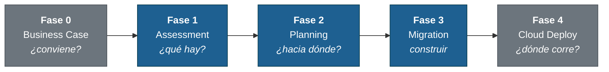

# Legacy Modernization Playbook — .NET Framework y Visual Basic

**Modernización de sistemas legacy .NET Framework y VB6 / VB.NET con GitHub Copilot**, con agentes que cubren el ciclo completo (assessment → planning → migración → cloud en Azure) y **evidencia verificable de cobertura 100% y de migración de reglas de negocio**. Diseñado para **Windows + PowerShell**.

Construido a partir de migraciones reales en banca, gobierno y telco en LATAM.

---

## Qué resuelve

En sistemas muy grandes, un agente de IA no cabe todo el código en contexto: resume, salta archivos o lee solo parte de cada uno, y aun así reporta "análisis completo". Las reglas de negocio de lo no leído se pierden.

Este playbook mueve la garantía **del LLM a las herramientas**:

| Problema | Mecanismo (skill [`legacy-coverage`](.github/skills/legacy-coverage/SKILL.md), PowerShell en `.github/skills/legacy-coverage/scripts/`) |
| --- | --- |
| No se sabe qué archivos existen | `Initialize-Ledger.ps1`: inventario de **todos** los archivos (líneas, bytes, SHA-256) |
| El agente lee "por encima" | `Read-LegacyChunk.ps1`: único modo de leer; **registra cada línea leída** (`read-log.tsv`) |
| El contexto se agota en apps grandes | Batches (un **subagente** por batch) + `Get-NextBatch.ps1` para **reanudar** |
| "Ya terminé" sin evidencia | `Test-Coverage.ps1`: gate 100% (líneas leídas, archivo → feature → disposición) |
| Reglas de negocio implícitas se pierden | `Find-RuleCandidates.ps1` (escáner determinista) + `Add-BusinessRule.ps1` → `BR-catalog.csv` |
| Se migra código pero no la regla | `Test-RuleTraceability.ps1`: regla → código (`BR-NNNN`) → pruebas pasando (TRX); críticas ≥2 |

Protocolos: [`coverage-protocol`](.github/skills/legacy-coverage/references/coverage-protocol.md) · [`business-rules-protocol`](.github/skills/legacy-coverage/references/business-rules-protocol.md) · Scripts: [`scripts/README.md`](scripts/README.md)

> **Límite honesto:** los gates prueban que cada línea **pasó por el lector** y que cada regla **tiene código y pruebas**; no que el modelo la *entendió* perfectamente. Se complementan con el escáner determinista, los checkpoints HITL y las pruebas de paridad.

---

## Caso real

Migración de un sistema VB6 de gestión de RRHH a WPF + .NET 10 siguiendo el playbook:

| Métrica | Resultado |
| --- | --- |
| Features migrados | 15 / 15 |
| Tests | **146 / 146 passed** (78 Domain + 24 Application + 44 Parity) |
| Build final | **0 errors, 0 warnings** |
| ADRs documentados | 9 |
| Arquitectura | Clean Architecture (Domain + Application + Infrastructure + WPF) |

---

## Metodología en cinco fases



Fases 1, 2 y 3 son requeridas. Fase 0 y 4 son opcionales pero recomendadas con cliente.

| Fase | Pregunta | Agente | Entregable / gate |
| --- | --- | --- | --- |
| 0. Business Case _(opc.)_ | ¿Vale la pena? | `@business-case-analyst` | TCO, ROI, riesgo, ejecutivo |
| 0. Security _(opc.)_ | ¿Qué riesgos hay? | `@security-assessor` | Reporte whitehat del legacy |
| **1. Assessment** | ¿Qué tiene el legacy? | `@dotnet-assessment` / `@vb-assessment` | `docs/features/`, ledger, `BR-catalog.csv` · **gates: cobertura 100% + reglas** |
| **2. Planning** | ¿A qué stack y por qué? | `@dotnet-planning` / `@vb-planning` | `docs/ARQUITECTURA-TARGET.md` + ADRs |
| **3. Migration** | ¿Cómo construirlo? | `@dotnet-migration` / `@vb-migration` | `src/` + `tests/` · **gate: trazabilidad regla → código → prueba** |
| 4. Cloud Deploy _(opc.)_ | ¿Dónde corre? | `@azure-architect` | `cloud-architectures/azure/` con IaC + precios |

Apoyo: `@modernization-strategy` (6 R's), `@plan-refiner`, `@migration-tester` (paridad).
Detalle: [`docs/methodology/00-overview.md`](docs/methodology/00-overview.md)

---

## Requisitos (Windows)

- Windows 10/11, **VS Code** + GitHub Copilot Chat
- **PowerShell 7** (`winget install Microsoft.PowerShell`); los scripts de cobertura también corren en Windows PowerShell 5.1
- **.NET 10 SDK** — `winget install Microsoft.DotNet.SDK.10`
- `git`; el código legacy completo (no solo binarios)

---

## Flujo end-to-end

### 1. Clonar (sin instalación ni configuración)

```powershell
git clone https://github.com/armandoblanco/legacy-modernization-playbook.git mi-proyecto
cd mi-proyecto
Remove-Item .git -Recurse -Force; git init
```

El repo ya viene listo para **.NET Framework** (`@dotnet-*`) y **VB6/VB.NET** (`@vb-*`): usa los agentes de tu tecnología y ignora los otros. Opcional: llena `.copilot-project.yml` (nombre, cliente, stack, cloud); lo que falte lo preguntan los agentes.

### 2. Cargar el legacy (read-only)

```powershell
Copy-Item C:\ruta\al\codigo\* legacy\ -Recurse
```

Copia **todo** (`.frm/.frx/.vbp`, `.config`, `.sql`, `.rpt`…): el gate exige leer cada archivo.

### 3. Fase 1 — Assessment con cobertura verificable

```text
@vb-assessment Analiza el sistema en legacy/        (o @dotnet-assessment)
```

El agente inicializa el ledger, trabaja por batches con subagentes, lee con `Read-LegacyChunk.ps1`, cataloga reglas de negocio y no cierra hasta que ambos gates dan exit 0:

```powershell
pwsh .github/skills/legacy-coverage/scripts/Test-Coverage.ps1 -Phase Assessment
pwsh .github/skills/legacy-coverage/scripts/Test-RuleTraceability.ps1 -Phase Assessment -Strict
```

Si se agota el contexto o se interrumpe: `pwsh .github/skills/legacy-coverage/scripts/Get-NextBatch.ps1 -Summary` y `@vb-assessment Continúa` (el estado vive en `docs/inventory/`).

### 4. Fase 2 — Planning

```text
@vb-planning Revisa el assessment y planifica la migración
```

Pregunta las decisiones críticas (stack, reemplazo de OCX/WCF/WebForms, ORM, MVVM…) y produce `ARQUITECTURA-TARGET.md`, `migration-plan.md` y un ADR por decisión.

### 5. Fase 3 — Migration

```text
@vb-migration Ejecuta la migración del sistema legacy
```

Feature por feature, con compile-and-test entre capas. Cada regla de negocio queda marcada en el código (`BR-NNNN`) y con pruebas cuyo nombre incluye el ID:

```powershell
dotnet test --logger trx --results-directory test-results
pwsh .github/skills/legacy-coverage/scripts/Test-RuleTraceability.ps1 -Phase Migration
pwsh .github/skills/legacy-coverage/scripts/Test-Coverage.ps1 -Phase Migration
```

Estructura generada: `<Proyecto>.Migrated.sln`, `src/`, `tests/`, `test-results/`, `migration/`.

### 6. Fase 4 (opcional) — Azure

```text
@azure-architect Diseña la arquitectura cloud para MiProyecto en Azure
```

---

## Tecnologías soportadas

| Tecnología | Agentes | Guía |
| --- | --- | --- |
| **.NET Framework 2.0–4.8** → .NET 10 | `@dotnet-assessment` · `@dotnet-planning` · `@dotnet-migration` | [`docs/QUICKSTART-dotnet.md`](docs/QUICKSTART-dotnet.md) |
| **VB6 y VB.NET legacy** → .NET 10 (WinForms / WPF / Blazor) | `@vb-assessment` · `@vb-planning` · `@vb-migration` | [`docs/technologies/vb/`](docs/technologies/vb/README.md) |

Compartidos: `@business-case-analyst`, `@security-assessor`, `@modernization-strategy`, `@plan-refiner`, `@migration-tester`, `@cloud-architect`, `@azure-architect`. Prompts reutilizables en `.github/prompts/` (p. ej. `verificar-cobertura`, `verificar-reglas-negocio`, `reanudar-sesion`).

---

## Documentación

- [`docs/AGENTS.md`](docs/AGENTS.md): catálogo de agentes con prompts de ejemplo
- [`docs/PROJECT-STRUCTURE.md`](docs/PROJECT-STRUCTURE.md): estructura del repo
- [`docs/PHILOSOPHY.md`](docs/PHILOSOPHY.md): filosofía y lecciones aprendidas
- [`docs/methodology/00-overview.md`](docs/methodology/00-overview.md): metodología de las 5 fases
- [`.github/skills/legacy-coverage/references/`](.github/skills/legacy-coverage/references/): protocolos de cobertura y reglas de negocio
- [`scripts/README.md`](scripts/README.md): herramientas PowerShell

## Contribuir

Casos reales, trampas técnicas no documentadas y mejoras a los scripts son bienvenidos vía issue o PR.

## Licencia

MIT: usa libremente, atribuye si quieres.
